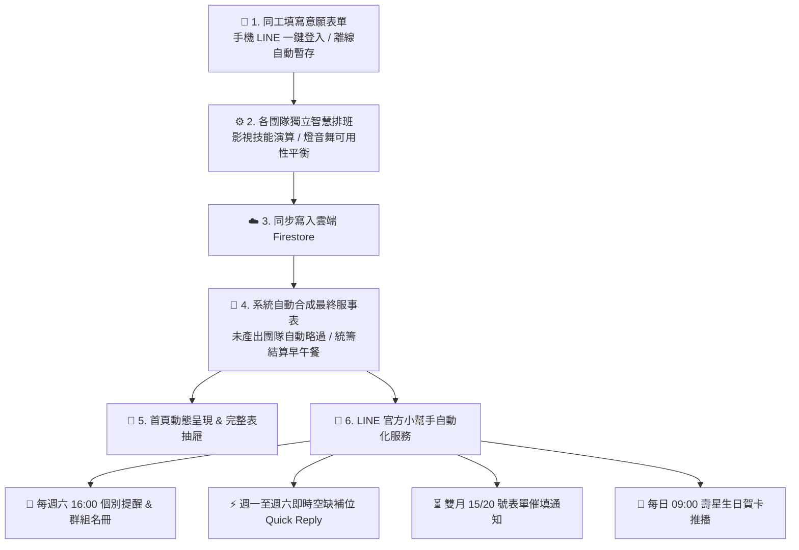

# 🏛️ BOL Production 智慧義工排班與 LINE 官方小幫手系統

> 專為靈糧堂轉播事工（影視、燈光、音控、舞監四大團隊）打造的**一站式自動化排班、RPG 技能成長、餐點統籌結算與 LINE 智慧通知生態系**。

---

## 📖 系統簡介：為什麼有這個系統？

在每週的主日崇拜轉播中，現場需要**影視、燈光、音控、舞監**四大專業團隊緊密配搭，跨越**山莊大堂**與**宣教大樓**兩大場地。

過去採用人工試算表排班時，常面臨以下痛點：
1. **多團隊時辰不一**：各團隊收單與排班節奏不同，難以同步整合成一張完整名冊。
2. **餐點統計繁重**：需手動逐一清點跨團隊、跨場地的早午餐出勤人數，耗時且易漏算。
3. **臨時缺人調度難**：遇到同工臨時請假，幹部需在各群組著急詢問。
4. **服事提醒易遺漏**：需要幹部手動每週提醒同工出勤。

**BOL Production 排班系統** 將表單收集、智慧演算法、多團隊班表合成、餐點計算與 LINE 官方帳號全自動串聯，讓服事安排變得既專業又輕鬆！

---

## 🔄 系統運作全景流程



---

## 🌟 四大核心功能亮點

### 1. 🎛️ 四大團隊獨立排班 × 最終服事表自動合成
- **各自獨立，互不卡關**：
  - **影視團隊**：採用技能權重演算法（精準媒合導播、攝影 CAM1~4、AD、平面攝影、信息版，並兼顧專職輪休與同工偏好）。
  - **燈光 / 音控 / 舞監團隊**：採用可用性平衡演算法，依同工填寫之可事奉日期與歷史累積服事次數進行平均分配。
  - 各團隊排好後即可各自同步備份至雲端，**尚未產出的團隊不會阻礙其他團隊**。
- **全自動合成最終完整表**：
  - 系統背景自動監聽，只要任一團隊同步，即自動將所有已產出的團隊整合成一張**跨場地完整大表**。
- **全場地 2 位備用人員設計**：
  - 每個團隊在山莊大堂與宣教大樓均預留最多 2 位後援待命名額（`備用1`、`備用2`）。
  - 演算法自動將當天未排上主責職位的可用同工排入備用；幹部亦可手動微調。

---

### 2. 🍱 智慧全場地餐點統籌結算
不需要人工逐一數人頭！在最終服事表階段，系統會自動統計當天實際出勤人數（包含正選職位與備用人員）：
- **山莊早餐數量**：統計山莊大堂所有出勤同工總數。
- **宣教早餐數量**：統計宣教大樓早班服事同工總數。
- **宣教午餐數量**：統計宣教大樓午班續留同工總數。
- 支援幹部於後台手動自訂修正，並自動寫入 Google Sheets 備份與 Excel 報表。

---

### 3. 🤖 LINE 官方帳號小幫手（24 小時智慧秘書）

| 功能項目 | 觸發時機 | 說明與特點 |
| :--- | :--- | :--- |
| **本週服事查詢** | 隨時私訊或群組輸入「本週服事」 | 立即回傳個人服事崗位或當週全體服事名冊。 |
| **每週服事推播** | 每週六下午 16:00 定時發送 | • **個人私訊**：推播專屬的「日期、場地、職位」（含備用待命提醒）。<br/>• **服事群組**：推播「當週四大團隊完整服事名冊與餐點預估」。 |
| **即時空缺補位** | 週一至週六同工私訊小幫手 | 系統會根據同工的 LINE UID 自動識別所屬團隊，若當週該團隊有空缺，自動跳出 `[MM/DD 可以幫忙！]` 快捷按鈕。同工點擊即可一秒補位，並即時更新班表與發信通知幹部。 |
| **備用人員防誤觸** | 即時判定 | **「備用人員」非主要服事空缺**，因此備用位空置時，絕不會被當成缺額發送補位呼叫，群組名冊亦自動隱藏空白備用欄位。 |
| **表單開放與催填** | 雙月 15 號 12:00 & 20 號 18:00 | 自動提醒同工下一期服事意願表單已開放填寫，並在截止前進行倒數催填。 |
| **壽星生日祝福** | 每天早上 09:00 | 自動比對當天生日同工，發送精美的祝福賀卡與聖經經文。 |

---

### 4. 🎮 RPG 風格技能樹與個人化儀表板
- **個人技能雷達圖**：將同工各項技能（導播、攝影、燈控、成音等）可視化為 RPG 能力雷達圖。
- **LINE 大頭照動態同步**：同工只要使用 LINE 登入，系統自動同步最新大頭貼至雲端名冊。
- **離線自動填表暫存**：即使在網路不穩的環境填寫表單，資料會暫存於手機，連上網路時自動同步回雲端。

---

## 🏛️ 場地與職位架構表

系統依據教會實體運作，將所有服事劃分為兩大場地：

```text
┌─────────────────────────────────────────────────────────────┐
│                       🏛️ BOL Production                     │
├──────────────────────────────┬──────────────────────────────┤
│        【山莊大堂】          │         【宣教大樓】         │
├──────────────────────────────┼──────────────────────────────┤
│ 🎥 影視：導播, AD, CAM1~4,   │ 🎥 影視：導播, 信息版        │
│          平面攝影, 備用1, 2  │          備用1, 2            │
│ 💡 燈光：燈控, 備用1, 2      │ 💡 燈光：燈控, 備用1, 2      │
│ 🎚️ 音控：山莊IN, 山莊OB,    │ 🎚️ 音控：宣教IN, 宣教OB,    │
│          備用1, 2            │          備用1, 2            │
│ 🎭 舞監：舞監, 備用1, 2      │ 🎭 舞監：舞監, 備用1, 2      │
└──────────────────────────────┴──────────────────────────────┘
```

---

## 👥 使用者操作指引

### 📱 一般同工（手機操作）
1. **登入系統**：點擊專屬連結，使用 LINE 帳號一鍵登入。
2. **首頁查班**：登入後即可看見自己近期的服事日期、地點與職位；亦可切換查看各團隊的完整排班。
3. **填寫意願**：雙月週期開放時，點選「填寫表單」勾選下期可事奉日期與服事組別。

### 👑 團隊幹部 / 管理員（後台排班三步驟）
1. **進入後台**：點選「進入後台管理」並切換至所屬團隊（影視 / 燈光 / 音控 / 舞監）。
2. **第一步：自動生成**：選擇排班週期，點選「自動生成排班」（系統自動從雲端回覆抓取資料並進行演算）。
3. **第二步：微調確認**：檢視排班結果，若有特定需求可直接點擊格子手動修改人員。
4. **第三步：同步雲端**：確認無誤後點擊「同步寫入雲端」，系統會立即儲存該團隊排班並自動觸發「最終服事表合成」。

---

## 💻 系統架構與技術棧（給工程/維運人員）

### 技術選型
- **前端框架**：React 19 + TypeScript + Vite
- **資料庫與身分驗證**：Google Firebase (Firestore)
- **伺服器端與排程**：Vercel Serverless Functions + Vercel Cron
- **社群整合**：LINE LIFF SDK + LINE Messaging API (Flex Messages / Webhook)
- **試算表備份**：Google Apps Script (GAS) + SheetJS (XLSX)

### 目錄結構速覽
```text
volunteer-scheduler/
├── api/                            # Vercel Serverless 後端
│   ├── line-webhook.ts             # LINE 訊息接收、意圖分析與即時補位
│   ├── cron-saturday.ts            # 週六 16:00 定時服事提醒推播
│   ├── cron-form-reminder.ts       # 雙月 15/20 號表單催填推播
│   ├── cron-birthday.ts            # 每日 09:00 生日祝福推播
│   └── utils/                      # 後端共用工具 (LINE SDK, Firebase Admin)
├── src/
│   ├── components/                 # 前端頁面與管理元件
│   │   ├── AdminSchedulerTeam.tsx  # 多團隊排班核心操作介面
│   │   ├── HomePage.tsx            # 首頁個人服事摘要與完整表抽屜
│   │   └── ...                     # 表單、名冊與技能樹元件
│   ├── utils/
│   │   ├── scheduler.ts            # 影視團隊技能權重排班演算法
│   │   ├── schedulerGeneric.ts     # 通用團隊可用性平衡排班演算法
│   │   ├── schedulerFinal.ts       # 最終服事表自動合成與餐點計算引擎
│   │   └── firebaseService.ts      # 前端 Firestore 服務層
│   └── App.tsx                     # 根元件與狀態路由
├── vercel.json                     # Cron 排程與路由設定
└── package.json
```

---

## 🚀 快速部屬與本地開發

```bash
# 1. 複製儲存庫
git clone https://github.com/david1990725/volunteer-scheduler.git
cd volunteer-scheduler

# 2. 安裝依賴套件
npm install

# 3. 複製環境變數設定
cp .env.example .env

# 4. 啟動本地開發伺服器
npm run dev
```

### 必要環境變數範例 (`.env`)
```env
# 前端 LINE LIFF
VITE_LIFF_ID=your_liff_id_here
VITE_APPS_SCRIPT_URL=your_gas_web_app_url

# LINE Messaging API (後端 Serverless 使用)
LINE_CHANNEL_ACCESS_TOKEN=your_channel_access_token
LINE_CHANNEL_SECRET=your_channel_secret

# Firebase 設定
VITE_FIREBASE_API_KEY=your_api_key
VITE_FIREBASE_PROJECT_ID=your_project_id
```

---

## 📄 授權條款 (License)

本專案採用 [MIT License](LICENSE) 開源授權，歡迎教會與非營利機構交流與參考使用。
